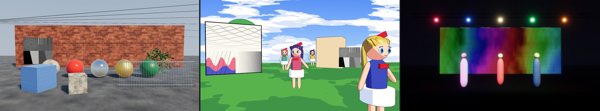
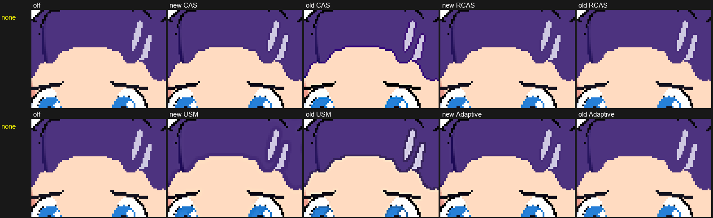
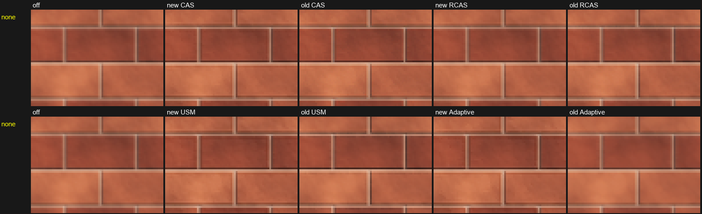
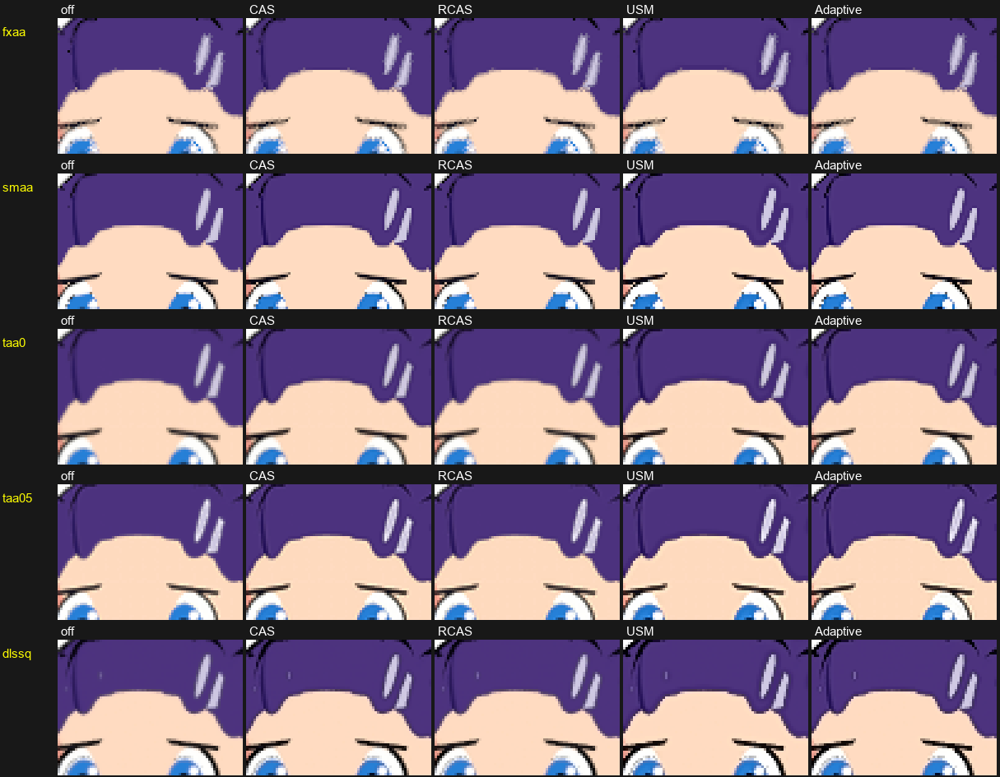
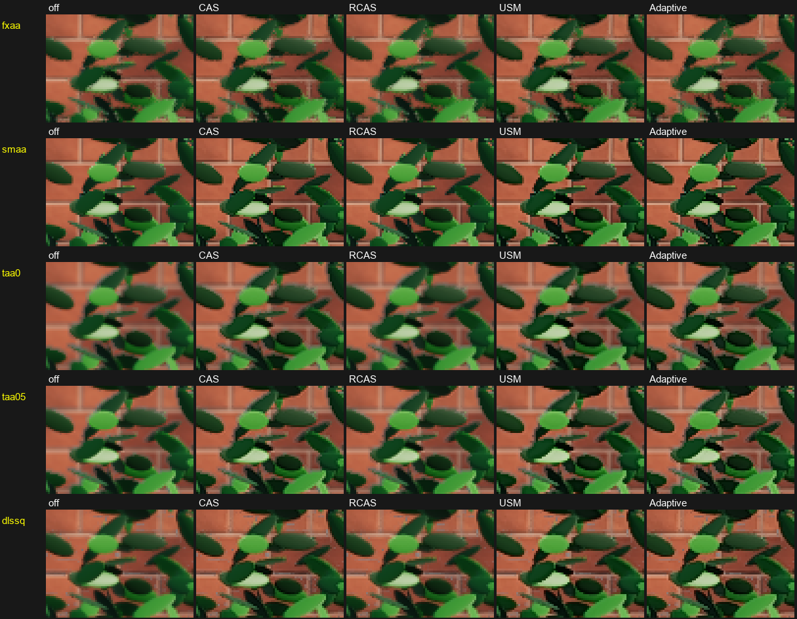

# 実描画での検証結果 (2026-11)

Unity 上で実際に描画した画像を使い、変更前（コミット `3b2fb79`、以下「旧版」）と現行版（以下「新版」）を比較した記録です。

## 検証環境と方法

| 項目 | 内容 |
|---|---|
| Unity / パイプライン | Unity 6000.3.15f1、HDRP 17.3.0、Direct3D 11、色空間 Linear |
| GPU | NVIDIA GeForce RTX 4090 |
| 解像度 | 1920x1080（負荷計測のみ 3840x2160） |
| 設定 | Intensity 1.0、Sharpness 0.5、Luminance Only オン、その他は既定値 |
| 実行方法 | エディタのバッチモードでカメラを描画し、PNG に保存して解析 |

シーンはスクリプトで生成した合成シーン 3 種です。実際の制作データではありません。

- **実写風**: PBR マテリアル、レンガ・布・岩の高周波テクスチャ、細いワイヤー、フェンス、葉、解像度チャート。ACES トーンマップ
- **アニメ風**: 2 階調のトゥーンシェーダー + 背面法アウトライン、ベタ塗り背景、線画、ハーフトーン。トーンマップなし
- **ライブステージ風**: 暗所、画素格子つき LED ウォール、スポットライト、ブルーム、フィルムグレイン

検証用のスクリプトは `Documents/Verification~/` にあります（`Capture.cs` と `Toon.shader` を HDRP プロジェクトの `Assets/Editor` と `Assets` に置き、`Capture.Setup` → `Capture.Run` → `Capture.Probe` をバッチモードで実行）。

### 指標

すべて知覚空間（ガンマ 2.0）の輝度で測っています。値 0.01 は 8bit でおよそ 2.5 階調です。

- **ゲイン**: 隣接画素差の平均が、シャープなしの何倍になったか
- **オーバーシュート / アンダーシュート**: 出力が、入力の 5x5 近傍の最大値を上回った量 / 最小値を下回った量。全画素の 99.9 パーセンタイル
- **ちらつき**: カメラを止めた連続 2 フレームの平均絶対差（0〜255）。シャープなしに対する倍率で示す

TAA / DLSS はフレームごとにジッターが変わるため、設定間で同じジッター位相のフレームを比較しています。DLSS は同じ位相でも出力が完全には一致しないので、ハロー量は「各 AA のシャープなし画像に、シェーダーを単体で適用した結果」で測りました。

## 1. 旧版との比較（AA なし）

| シーン | モード | ゲイン 旧 → 新 | オーバーシュート 旧 → 新 | アンダーシュート 旧 → 新 |
|---|---|---|---|---|
| 実写風 | CAS | 1.23 → 1.37 | 0.016 → 0.011 | 0.085 → 0.032 |
| 実写風 | RCAS | 1.27 → 1.17 | 0.039 → 0.011 | 0.060 → 0.020 |
| 実写風 | USM | 1.37 → 1.38 | 0.054 → 0.011 | 0.087 → 0.032 |
| 実写風 | Adaptive | 0.99 → 1.47 | 0.003 → 0.011 | 0.003 → 0.033 |
| アニメ風 | CAS | 1.14 → 1.09 | 0.016 → 0.010 | 0.104 → 0.031 |
| アニメ風 | RCAS | 1.06 → 1.03 | 0.019 → 0.005 | 0.039 → 0.020 |
| アニメ風 | USM | 1.20 → 1.15 | 0.051 → 0.010 | 0.092 → 0.032 |
| アニメ風 | Adaptive | 1.01 → 1.14 | 0.001 → 0.010 | 0.000 → 0.032 |

- **ハロー**: 新版は Overshoot 0.01 / Undershoot 0.03 の設定どおりに収まっています。旧版の CAS / USM は、髪と肌の境界などに暗い縁取りが出ていました（アンダーシュート 0.09〜0.10）。
- **Adaptive**: 旧版はゲインがほぼ 1.0 で、実質的にシャープが掛かっていませんでした。新版は 1.14〜1.47 です。
- **RCAS**: 旧版は Sharpness を 0.5 → 1.0 に変えても結果が変わりませんでした（ゲイン 1.268 のまま）。新版は 1.17 → 1.39 と効きます。
- **USM**: 同じゲインのまま、ハローが 1/3〜1/5 になりました。

## 2. アンチエイリアス / DLSS との相性

確認した組み合わせは、AA なし、FXAA、SMAA、TAA（Sharpen Strength 0 と 0.5）、DLSS Quality（内部 1282x722 → 1920x1080）、DLAA です。

### ハロー

SMAA / TAA / DLSS Quality / DLAA のどの出力に適用しても、オーバーシュートは最大 0.013、アンダーシュートの 99.9 パーセンタイルは 0.031 以下でした（設定値 0.01 / 0.03 + 8bit の量子化誤差）。DLSS Quality（動的解像度あり）でも、シャープ位置のずれは見られません。

### ちらつき（シャープなしに対する倍率）

| シーン | AA | CAS | RCAS | USM | Adaptive |
|---|---|---|---|---|---|
| 実写風 | TAA (Sharpen 0) | 1.35 | 1.15 | 1.44 | 1.57 |
| 実写風 | TAA (Sharpen 0.5) | 1.37 | 1.17 | 1.44 | 1.59 |
| 実写風 | DLSS Quality | 1.34 | 1.15 | 1.39 | 1.46 |
| 実写風 | DLAA | 1.33 | 1.15 | 1.36 | 1.44 |
| アニメ風 | TAA (Sharpen 0) | 1.21 | 1.08 | 1.35 | 1.36 |
| アニメ風 | TAA (Sharpen 0.5) | 1.20 | 1.10 | 1.33 | 1.44 |
| アニメ風 | DLSS Quality | 1.10 | 1.00 | 1.14 | 1.18 |
| アニメ風 | DLAA | 1.08 | 1.01 | 1.15 | 1.16 |

- シャープは時間方向のちらつきも、ゲインとほぼ同じ割合で強めます。**RCAS が最も増幅が小さく**、TAA / DLSS 後のリカバリに向きます。
- **CAS のノイズゲート**: この検証で、CAS がアニメ風 + DLSS の平坦部（肌など）にざらつきを出すことが分かりました（ちらつき 2.17 倍）。CAS にも Noise Threshold を適用するよう修正し、1.10 倍になりました。上の表は修正後の値です。
- **TAA の Sharpen Strength**: 0.5 にすると、ProSharpen を掛ける前の時点でちらつきが実写風で 15%、アニメ風で 49% 増えます。ProSharpen を使う場合は 0 を推奨します。

### FXAA

HDRP は FXAA を最終パス（カスタムポストプロセスの後）で実行します。そのため FXAA は ProSharpen の結果をぼかし、実写風シーンではシャープの効果（ゲイン − 1）が 5〜7 割に下がりました。FXAA よりも SMAA / TAA / DLSS との併用を推奨します。

### フィルムグレイン

HDRP のフィルムグレインも最終パスで加わるため、ProSharpen がグレインを増幅することはありません。

## 3. 負荷

3840x2160 のフルスクリーンパス 1 回あたりの GPU 時間です（RTX 4090、1500 回連続描画の平均、最小値を採用）。単純なコピーが 0.023 ms なので、差分がシャープ処理の正味のコストです。

| モード | タップ数 | Luminance Only オン | オフ (RGB) |
|---|---|---|---|
| （コピーのみ） | 1 | 0.023 ms | — |
| CAS Realtime | 5 | 0.036 ms | 0.059 ms |
| RCAS Realtime | 5 | 0.039 ms | 0.067 ms |
| CAS High | 9 | 0.063 ms | 0.071 ms |
| RCAS High | 9 | 0.062 ms | 0.083 ms |
| USM Realtime | 9 | 0.064 ms | 0.080 ms |
| Adaptive | 9 | 0.066 ms | 0.096 ms |
| USM High | 25 | 0.161 ms | 0.170 ms |
| シャープ量 0 の画素（マスク外など） | 1 | 0.023 ms | — |

計測のばらつきは ±5% 程度です。

### 最適化のレビュー

- **負荷はほぼタップ数で決まります。** 演算の削減（平方根の再利用など）を試しましたが、計測誤差に埋もれて差は出ませんでした。出力はビット単位で一致するため、変更自体は残しています。
- **シャープ量 0 の早期リターン**を追加しました。マスクや深度連動でシャープ量が 0 になる画素は、近傍を読まずにコピーと同じコストで抜けます（Adaptive で 0.066 → 0.023 ms）。出力は変わりません。
- **Luminance Only はオンが軽い**です（既定でオン）。RGB 処理は 1.1〜1.7 倍のコストになります。
- **USM High は Radius が 1.3 を超えるときだけ使う**のが妥当です。Radius 1.0 では Realtime とほぼ同じ結果になり、コストは 2.5 倍です。
- 結果を変えずにタップ数を減らす方法は見つかりませんでした。USM High を 2 パスの分離型ガウスにすれば約 4 割軽くなる見込みですが、中間テクスチャと追加パスが必要で、HDRP / URP 両方の経路が複雑になるため今回は見送りました。

## 検証していないこと

- 実際の制作シーン（キャラクターモデル、実写素材）での見た目
- URP での実描画（コンパイルと、URP 用 SubShader 単体での出力のみ確認）
- HDRP のレイヤーマスク用パス（`ProSharpenStencilMaskPass`）の描画結果
- HDR ディスプレイ出力、XR、MSAA
- RTX 4090 以外の GPU での負荷
- カメラが動いている最中の画質（移動中のフレームは保存しましたが、定量評価はしていません）
